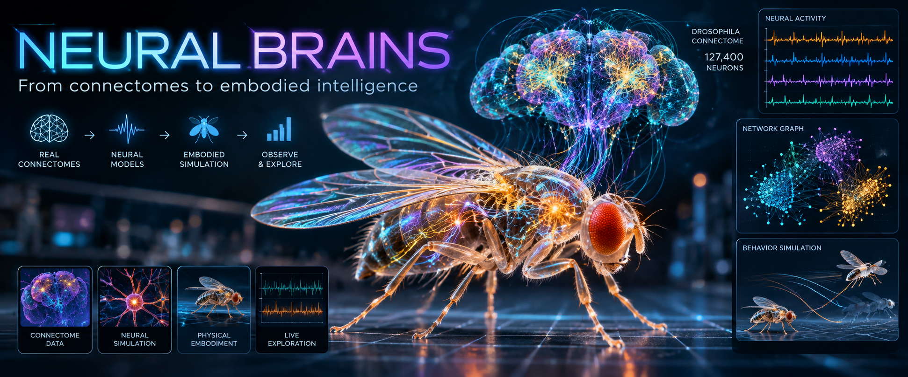

# neural-brains



Building connectome-informed neural and embodied models across species.
The fruit fly is the first active simulation: **127,400 neurons**, physical
walking/flight and live neural inspection in one browser.

**Research prototype:** learned motor control and assisted transitions are not
a complete biological fly.

## Launch the fly model

After [setup](readme-2.md), set `FLY_DATA_DIR` to your verified external data directory:

```bash
: "${FLY_DATA_DIR:?Set FLY_DATA_DIR to your existing external data directory}"
MUJOCO_GL=egl .venv-biomechanics/bin/python scripts/fly_habitat.py \
  --backend unified --flight-avoidance --neural-leg-extension \
  --data-dir "$FLY_DATA_DIR" \
  --output-dir "$FLY_DATA_DIR/results/fly-unified/session-$(date +%Y%m%d-%H%M%S)"
```

Set the variable in the same terminal used to launch; activating a virtual
environment does not set it. The data directory must be outside this repository,
and the output directory must not already exist.

Open **http://127.0.0.1:8840/** — one instance only. Use **Fullscreen ground**
and toggle eye/neural overlays.

**Brain-guided hybrid walking and assisted landing are enabled by default.**
[Evidence and limitations](docs/brain-guided-walking.md): real neural outputs
request walking speed/turns, but sensory drive, learned legs/wing control and
transition assistance are not complete biological autonomy.

The [puddle/leaf habitat](docs/puddle-habitat.md) includes food, sugar and sensory
proxies, with a dry-soil spawn. Water is a rigid collision prototype by default;
`--fluid-physics` enables experimental buoyancy/drag, not CFD or swimming.
Island traversal remains experimental. Use
`--no-brain-guided-walking --no-brain-linked-landing` for older comparisons.

[Whitepaper (PDF)](docs/neural-brains-whitepaper.pdf) · [Technical reference](readme-2.md)
